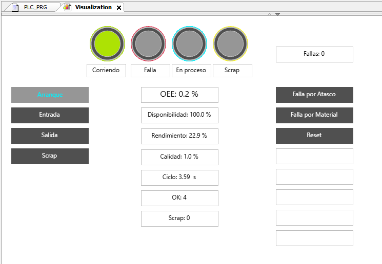
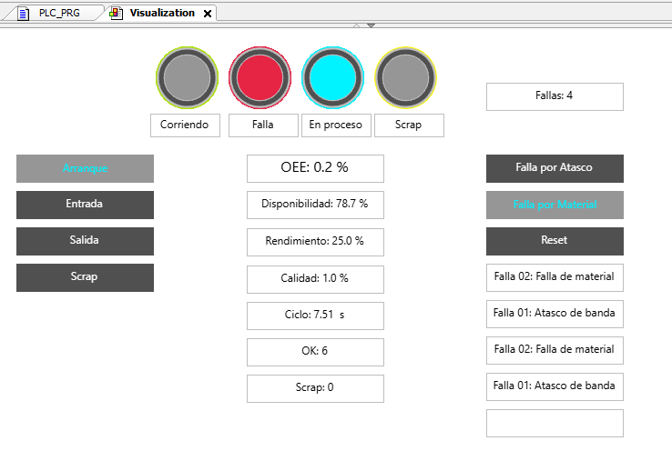
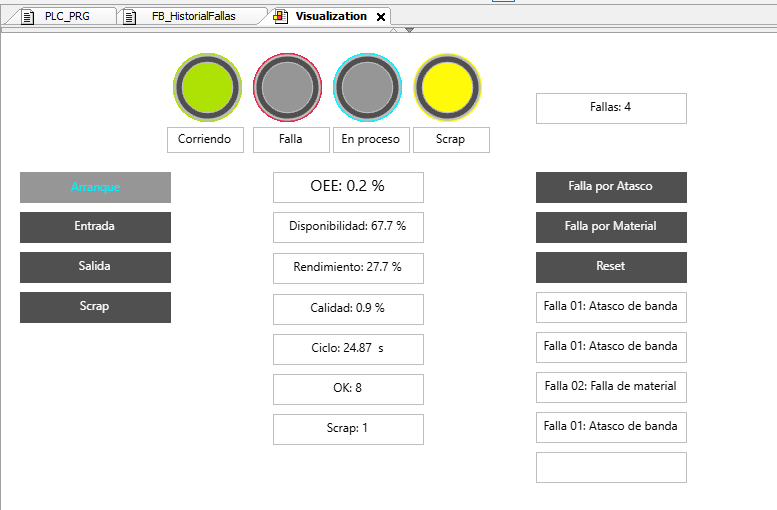
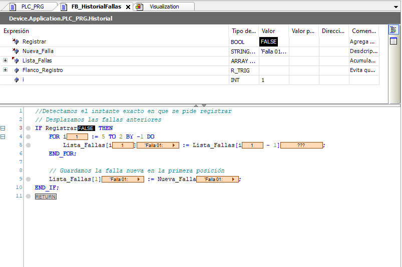

# Sistema de Monitoreo OEE y Trazabilidad de Fallas (IEC 61131-3 / ST)

## Descripción del Proyecto
Sistema de diagnóstico y métricas de producción desarrollado en **CODESYS V3.5 (SP22)** utilizando **Texto Estructurado (ST)**, estructuras de datos (`STRUCT`) y bloques de función modulares (`FB`).

Este sistema resuelve **3 necesidades críticas de manufactura**:
* **Medición dinámica del tiempo ciclo:** Captura precisa mediante flancos ascendentes (`R_TRIG`) y temporizadores internos (`.ET`) entre sensores de entrada y salida.
* **Trazabilidad de paros (FIFO):** Registro desplazable de las últimas 5 fallas encapsulado en un bloque de función reutilizable (`FB_HistorialFallas`).
* **Visibilidad en tiempo real del OEE:** Cálculo continuo de **Disponibilidad**, **Rendimiento** y **Calidad** con protección matemática contra divisiones entre cero.

---

## Arquitectura Modular y Fórmulas OEE

* **`ST_MetricasLinea` (`STRUCT`):** Agrupa contadores de producción (`Piezas_OK`, `Piezas_Malas`, `Total_Fallas`), tiempos acumulados en segundos (`REAL`) y los indicadores porcentuales (`0.0 %` a `100.0 %`).
* **`FB_HistorialFallas` (`FUNCTION_BLOCK`):** Gestiona un arreglo `ARRAY[1..5] OF STRING(40)` mediante un bucle inverso (`FOR i := 5 TO 2 BY -1`) para mantener las alarmas más recientes en la parte superior.

### Indicadores Calculados
* **Disponibilidad (%):** `(Tiempo_Operativo / Tiempo_Total) * 100`
* **Rendimiento (%):** `((Piezas_Totales * Tiempo_Ciclo_Ideal) / Tiempo_Operativo) * 100`
* **Calidad (%):** `(Piezas_OK / Piezas_Totales) * 100`
* **OEE Global (%):** `(Disponibilidad * Rendimiento * Calidad) / 10000`

---

## Simulación HMI — Escenarios Validados

### 1. Operación Nominal y Cálculo OEE

### 2. Diagnóstico de Paros e Historial Desplazable (FIFO)

### 3. Detección de Scrap e Impacto en Calidad

### 4. Arquitectura de Código Estructurado y Bloques Modulares

